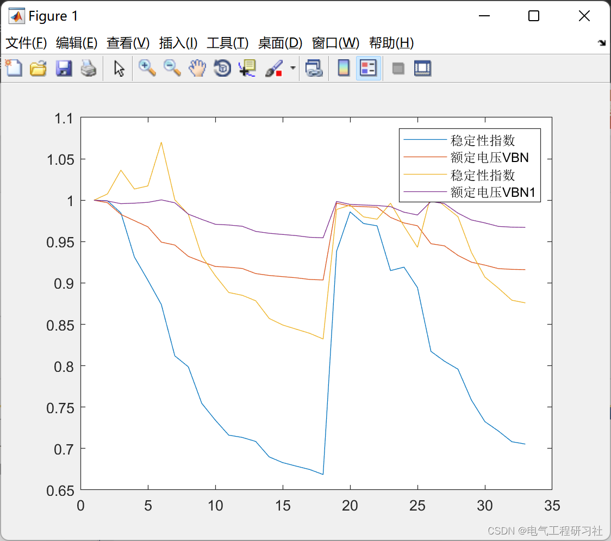
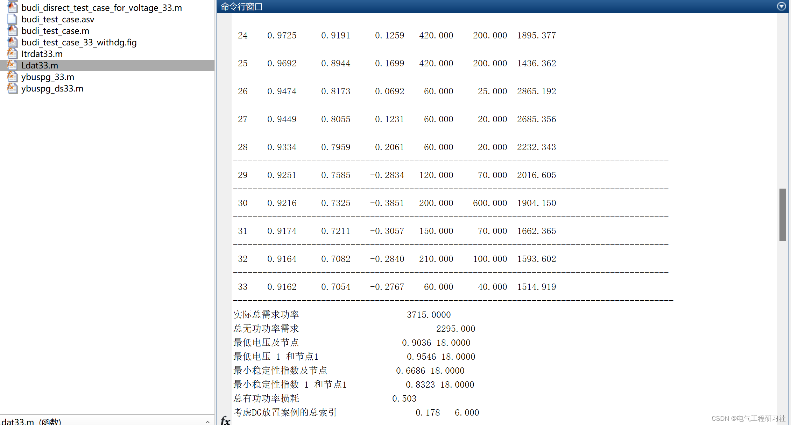
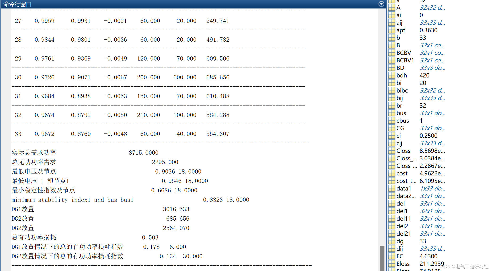

# Location and Capacity Selection for Distributed Energy in IEEE30 Nodes Realization

​  
This article is organized as follows: ⛳️⛳️⛳️ 1. Location selection and capacity determination for distributed energy sources (DG) 2. Operational results 3. MATLAB code implementation 4. Final thoughts
High energy quality and other advantages. According to the primary energy used by DG, it can be mainly divided into two categories: Renewable Energy DG and Non-renewable Energy DG.
DG. Renewable energy DG mainly includes small wind power generation and solar photovoltaic power generation. Its characteristic is that the output is restricted by natural conditions. Not under the control of scheduling personnel; Non-renewable energy DG mainly includes gas turbine power generation. Fuel cell power generation and natural gas power generation, etc. Its characteristic is that it has good adjusting ability. Dispatchers can control the active power P and reactive power Q issued. Research shows that DG grid-connected has a great impact on the distribution network. Including voltage levels, Network loss Reliability and other aspects, Moreover, its impact is closely related to the installation location and capacity of DG. Reasonable installation location and capacity can effectively improve the voltage quality of the power distribution network. Reduce active power loss. Increase system load rate.Unreasonable configuration will have the opposite effect. Even threaten the safe and stable operation of the power grid. Therefore, To fully leverage the positive impact of DG on the distribution network, During the planning stage, it is essential to conduct in-depth research on the optimal installation location and installed capacity of Distributed Generation (DG) connected to the distribution network.
2 Running Results Editing
3 Matlab Code Implementation
This document only showcases a portion of the code, all codes can be found in:
function ybus=ybuspg_ds33\nline_dat=Ldat33;\nb_dat=Bdat33;\nfb=line_dat(:,2);tb=line_dat(:,3);\nRes=line_dat(:,4);\nXe=line_dat(:,5);\nBs=line_dat(:,6);   % Ground impedance, B/2...\na = line_dat(:,7);              % Set value of tuning wheel..\nz = Res + 1i*Xe;                    % Impedance matrix...\ny = 1./z;                       % Node admittance\nb = 1i*Bs;                        % Make B a virtual part...\nnb = max(max(fb),max(tb));      % Number of nodes...\nybus = zeros(nb,nb);               % Initialize the node admittance matrix...\n br=max(line_dat(:,1));  % br= number of branches\n bus=max(line_dat(:,3)); % bus= Number of nodes\n baseMva=max(b_dat(:,7));   % Base power\n baseKv=12.62; % Base voltage\n z=zeros(bus,bus);\n zpu=zeros(bus,bus);\n for ii=1:br\n      x=line_dat(ii,2);\n      y=line_dat(ii,3);\n z(x,y)=complex(line_dat(ii,4),line_dat(ii,5)); % Convert a and y in pu\n zpu(x,y)=z(x,y)*baseMva/(((baseKv)^2)*1000);\n end\n ybus=zeros(bus,bus);\nfor ii=1:br\n    x=line_dat(ii,2);\n      y=line_dat(ii,3);\n    ybus(x,y)= -(1/zpu(x,y))/a(x);\n    ybus(y,x)= -(1/zpu(x,y))/a(x);\n    ybus(x,x)= ((ybus(x,x)-ybus(x,y))/a(x))+(1i*(line_dat(ii,6)/2));\n    ybus(y,y)= (ybus(y,y)-ybus(y,x)/a(x));\nend\nybus;\n  
4. End Notes - The references to theoretical concepts are from online sources, and if any infringement is found, please contact the blogger for removal.

## Images

<!-- PAYMENT_BLOCK -->

## Get this dataset

- Payment link (Stripe): [Buy now](https://buy.stripe.com/3cs8yP7sY87d0vu9AB)
- Payment QR code: 

<!-- /PAYMENT_BLOCK -->
